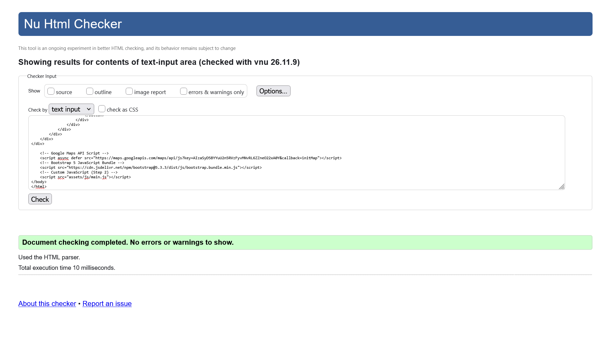
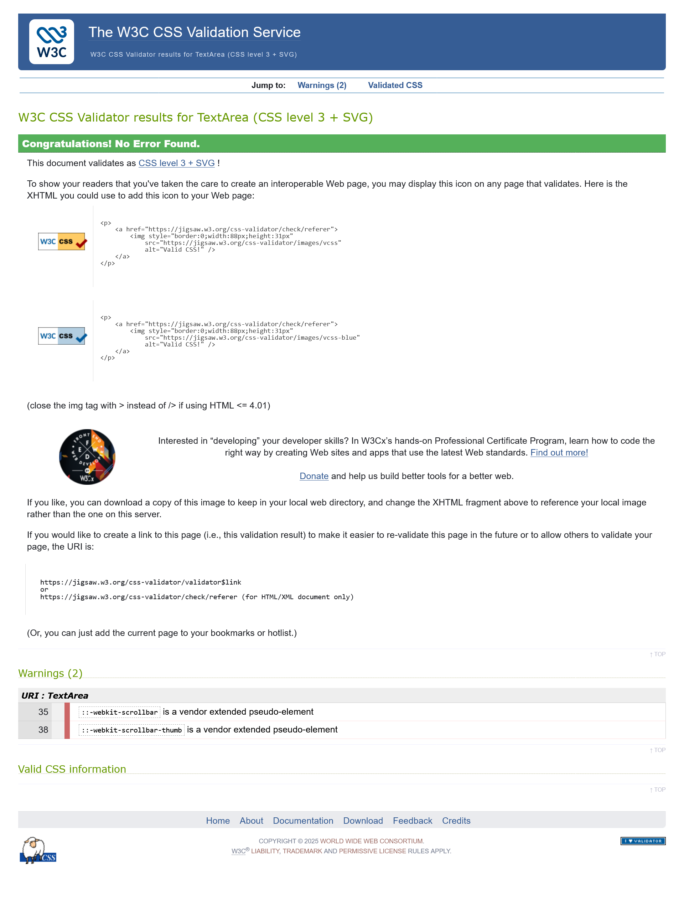

# DestinationFinder - Project Documentation

## [View the live project here](https://jaibe-444.github.io/Destination-Finder/)
This is an interactive holiday planning and destination discovery web application built as an academic project. It is designed to be responsive and accessible across a range of devices, making it easy to navigate for travelers looking for attractions, accommodations, and dining experiences.

---

## User Experience (UX)
- User stories
  - First Time Visitor Goals
    1. As a First Time Visitor, I want to easily understand the main purpose of the site and learn more about global holiday destinations.
    2. As a First Time Visitor, I want to be able to navigate throughout the site easily to find content.
    3. As a First Time Visitor, I want to look at ratings and reviews to understand how trusted destinations are, and locate social media or contact info.
  - Returning Visitor Goals
    1. As a Returning Visitor, I want to find new curated holiday packages.
    2. As a Returning Visitor, I want to find the best way to get in contact with travel specialists.
    3. As a Returning Visitor, I want to access community and support links.
  - Frequent User Goals
    1. As a Frequent User, I want to check for newly added destination listings and special deals.
    2. As a Frequent User, I want to use the live search and filtering tools to narrow down specific categories (Sights, Stays, Food).
    3. As a Frequent User, I want to interact with modal pop-ups to review full destination details and pricing.

---

## Design
- Colour Scheme
  - The primary colour palette utilizes Bootstrap dark tones paired with vibrant warning yellows and clean whites for high contrast and readability.
- Typography
  - **Montserrat** is used for clean, modern headings, while **Open Sans** serves as the readable body font.
- Imagery
  - High-resolution photography from Unsplash is integrated into hero headers, destination cards, and modal pop-ups to provide an inspiring travel aesthetic.

---

## Features
- Fully responsive layout across mobile, tablet, and desktop devices
- Interactive search bar and category filtering (All, Sights, Stays, Food)
- Google Maps JavaScript API integration with dynamic auto-fitting `LatLngBounds` markers
- Dynamic Bootstrap modals displaying detailed destination info, reviews, and booking prompts
- Featured holiday packages with interactive booking confirmation alerts

---

## Technologies Used
Languages Used
- HTML5
- CSS3
- JavaScript (ES6)

Frameworks, Libraries & Programs Used
- **Bootstrap 5.3.3**: Used to build a responsive grid system, navigation bars, cards, and modal components.
- **Bootstrap Icons**: Utilized for UI iconography across destination cards, headers, and buttons.
- **Google Fonts**: Imported Montserrat and Open Sans fonts for typography.
- **Google Maps JavaScript API**: Used to render interactive maps, custom markers, and info windows.
- **Git**: Used for version control, committing, and pushing code changes.
- **GitHub & GitHub Pages**: Used to store the repository code and deploy the live web application.

---

## Testing & Quality Assurance
The application underwent thorough testing across multiple dimensions:

- **Performance & Accessibility Testing:** Audited using [Google Lighthouse / PageSpeed Insights](https://pagespeed.web.dev/) to evaluate performance, best practices, SEO, and accessibility metrics.
- **Code Validation:** Verified semantic correctness using the [W3C Nu HTML Checker](https://validator.w3.org/) and checked styling integrity using the [W3C CSS Validator](https://jigsaw.w3.org/css-validator/).
- **Cross-Browser Compatibility:** Tested and verified layout consistency and interactive features across **Google Chrome, Mozilla Firefox, Microsoft Edge, and Opera**.

---
## Bugs
- **Note on External Links:** GitHub markdown automatically opens standard markdown links `[Text](URL)` in new tabs depending on user settings, which is why raw `target="_blank"` tags can occasionally be stripped out by the parser.
  
## Troubleshooting & Errors Fixed
During development, several key technical and validation challenges were successfully resolved:
1. **Google Maps API Integration:** Resolved initial `InvalidKeyMapError` and marker clipping issues by implementing asynchronous callback loading and wrapper `LatLngBounds` bounding-box logic.
2. **W3C Heading Hierarchy Errors:** Corrected semantic heading level jumps (e.g., ensuring `h2` elements are correctly followed by `h3` rather than skipping straight to `h5`/`h6`).
3. **HTML Structure Balance:** Cleaned up unclosed tags and container nesting within the main grid layout to achieve 100% W3C validation compliance.

---

## Development Resources & Acknowledgements
- **Learning & Reference:** 
    - [W3Schools](https://www.w3schools.com/) – Core reference for HTML, CSS, and JavaScript DOM manipulation syntax.
    - [Replit](https://replit.com/) – Utilized for collaborative code prototyping and testing.
    - [YouTube Tutorial Guide](https://youtu.be/NfvtQ2p5QG4) – Consulted for responsive layout design strategies and UI structuring.
- **Image Sources:** 
    - **[Unsplash](https://unsplash.com)** – Provided all high-resolution photography used for destination cards, hero backgrounds, and modal views under their free-to-use license.

---

### My Development Approach
- I practice the code on w3schools.com platform
- Compile the code on Replit.com IDE
- And copy the code to my IDE / Visual studio code
- This is mainly to avoid too much messy work on my IDE
- **I left the commented out code on main.js. This to make it easier for me to edit**

---
      
## 📁 Project File Structure

```text

Destination-Finder/
├── index.html
├── README.md
└── assets/
    ├── css/
    │   └── style.css
    ├── images/
    │   └── favicon.png
    └── js/
        └── main.js

```
## Project Screenshots & Validation

### 1. W3C Nu HTML Checker Results


### 2. W3C CSS Validator Results



AI Tools & Development Assistance
For faster coding and to avoid type or logic errors encountered during testing (such as on Python Tutor), I used Google Gemini as a coding assistant and teacher to help build, understand, and refine core JavaScript functions.

Gemini assisted in generating initial code structures for the following functions:

func initMap

func renderDestinations

func openDestinationModal

func updateMapMarkers

func filterAndSearch

All generated functions were subsequently reviewed, customized, and integrated to fit the specific project requirements. Beyond code generation, Gemini was used interactively to gain a deeper, step-by-step understanding of complex logic and syntax.

## An example of how I use Google Gemini - I tried writing the "cardHTML" element syntax on the HTML file but got several errors, then Gemini suggested generating it inside the main.js file for the following reasons..
# According to Google Gemini..
"
Building the cardHTML template inside JavaScript instead of hardcoding every card in index.html is a foundational web development pattern called Dynamic DOM Rendering.

Here are the four main reasons why this approach is used—especially useful to explain if you are presenting your code for an academic assessment:

1. Real-Time Searching and Filtering
In DestinationFinder, users can type a city name into the search bar or click category buttons (Sights, Stays, Food). Because the cards are generated by renderDestinations(items) in JavaScript, the app can instantly wipe the results container (container.innerHTML = "") and rebuild only the cards that match the user's filter—without reloading the webpage. If the cards were hardcoded in HTML, you would have to manually write extra code to hide and show individual HTML elements.

2. Avoiding Code Repetition (DRY Principle)
In software engineering, DRY stands for Don't Repeat Yourself. Every destination card shares the exact same Bootstrap layout (<div class="card">, image column, title, rating badge, and "View Deal" button). Writing that 15-line block of HTML once inside a JavaScript .forEach() loop means you don't have to copy and paste it 5, 50, or 500 times in index.html. If you ever want to change the button color or card padding, you only edit it in one place.

3. Separation of Data and Presentation
Keeping the destination details in a JavaScript array (destinationsData) separates your data from your layout (index.html). Adding a new destination to the website only requires adding a new object to that array—JavaScript automatically generates both the card on the left and the matching pin on the Google Map on the right.

4. Scalability for Real APIs
In real-world web applications, destination lists aren't stored inside HTML files; they come from external databases or live APIs (like Google Places or TripAdvisor). Writing renderDestinations() to loop through an array of data objects means your frontend is already built to handle live API data seamlessly.

Summary for your presentation: Hardcoding HTML is great for static sections that never change (like your navbar, hero banner, and footer), whereas generating cardHTML in JavaScript makes the search results interactive, scalable, and easy to maintain."

---
## Sample Code
## Function to Render Destination Cards Dynamically with Modal Trigger.
function renderDestinations(items) {
    const container = document.getElementById("results-container");
    container.innerHTML = "";

    if (items.length === 0) {
        container.innerHTML = `<p class="text-muted text-center py-4">No destinations found matching your criteria.</p>`;
        updateMapMarkers([]);
        return;
    }

    items.forEach(dest => {
        const cardHTML = `
            <div class="card mb-3 shadow-sm border-0">
                <div class="row g-0">
                    <div class="col-4">
                        
                    </div>
                    <div class="col-8">
                        <div class="card-body py-2 px-3">
                            <h3 class="card-title fw-bold fs-6 mb-1">${dest.name}</h3>
                            <p class="text-muted small mb-1"><i class="bi bi-geo-alt text-danger me-1"></i>${dest.address}</p>
                            <div class="mb-2">
                                <span class="badge bg-warning text-dark">★ ${dest.rating}</span>
                                <span class="text-muted small ms-1">(${dest.reviews} reviews)</span>
                            </div>
                            <button class="btn btn-sm btn-outline-primary py-0" onclick="openDestinationModal(${dest.id})">View Deal</button>
                        </div>
                    </div>
                </div>
            </div>
        `;
        container.innerHTML += cardHTML;
    });

    updateMapMarkers(items);
}
